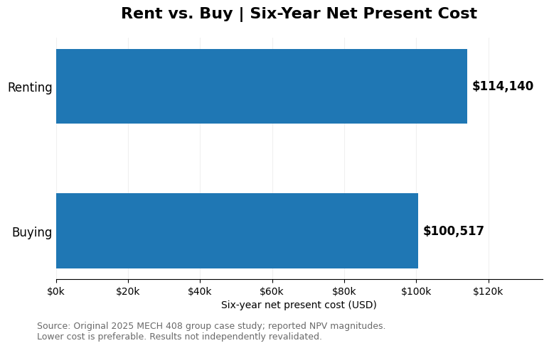

# Rent vs. Buy: Six-Year Housing Cost Analysis

**Tools:** Microsoft Excel, MATLAB  
**Project Type:** Financial Modeling and Sensitivity Analysis  
**Course:** MECH 408 – Applied Engineering Economy  
**Completed:** Spring 2025 (Group Project)

## Project Overview

This project evaluates whether renting an apartment or purchasing a home would be the more financially advantageous option for a graduate student living in Fort Collins, Colorado, for six years.

The analysis compares initial expenses, recurring monthly costs, financing, property appreciation, and the financial impact of selling a home at the end of the six-year period.

A 72-month Excel model was developed to calculate the net present value (NPV) of both alternatives.

## Project Files

- [View Original Excel Model](excel/rent-vs-buy-original.xlsx)
- [View Original Project Report (PDF)](report/rent-vs-buy-original-report.pdf)

The Excel workbook contains the original calculations and financial models developed for this case study. The PDF report documents the methodology, assumptions, results, and conclusions from the original group project.

## Objectives

- Calculate the financial costs of renting versus buying over six years.
- Account for the time value of money.
- Model mortgage payments, home appreciation, and remaining loan principal.
- Evaluate how changes in key assumptions affect the results.
- Compare alternatives and identify important financial trade-offs.

## Methodology

### Renting Scenario

The rental model includes:

- Starting monthly rent of $1,400
- Monthly utilities of $250
- Monthly renters insurance of $30
- Nonrefundable deposit of $1,200
- Annual rent increases of 4%

Monthly expenses were calculated over the six-year period and discounted to present value.

### Buying Scenario

The homeownership model considers:

- Home purchase price of $275,000
- Down payment and closing costs
- Mortgage payments and remaining principal
- Property taxes, insurance, HOA fees, and maintenance
- Property appreciation
- Home resale proceeds at the end of six years

An amortization schedule was used to track the mortgage balance over time.

### Financial Analysis

A 5% annual discount rate was used to calculate present values. Sensitivity analysis explored how changing financial assumptions affected the comparison.

Excel and MATLAB were used to analyze and visualize the results.

## Original Results

The original report documented the following net present values:

| Alternative | Net Present Value |
|---|---:|
| Renting | -$114,140.02 |
| Buying | -$100,517.30 |

Under the reported NPV calculations, buying had the less negative net present value.

The original report also included cumulative-cost comparisons and discussion of the financial flexibility associated with renting.

**Validation note:** The cumulative-cost discussion and NPV-based interpretation in the original report require reconciliation before making a definitive recommendation. These values are preserved here as originally reported.

## Results Visualization

The original model reported a net present cost of approximately $114,140 for renting and $100,517 for buying over six years.

Under these assumptions, buying had approximately $13,623 less in discounted net costs. These figures are taken from the original coursework and have not yet been independently revalidated.

## Skills Demonstrated

- Excel financial modeling
- Mortgage amortization
- Net present value calculations
- Sensitivity analysis
- Scenario comparison
- MATLAB and Excel visualization
- Technical reporting

## Limitations

The analysis uses hypothetical housing and financing assumptions from a 2025 academic assignment. Results depend on assumptions about rent increases, mortgage terms, home appreciation, and resale value.

This model is an educational financial comparison, not a current housing market forecast.

## Project Background

Originally completed as a collaborative case study for MECH 408 at Colorado State University in Spring 2025.

The original Excel workbook and report represent group coursework. Subsequent individual revisions, if added, will be identified separately.
