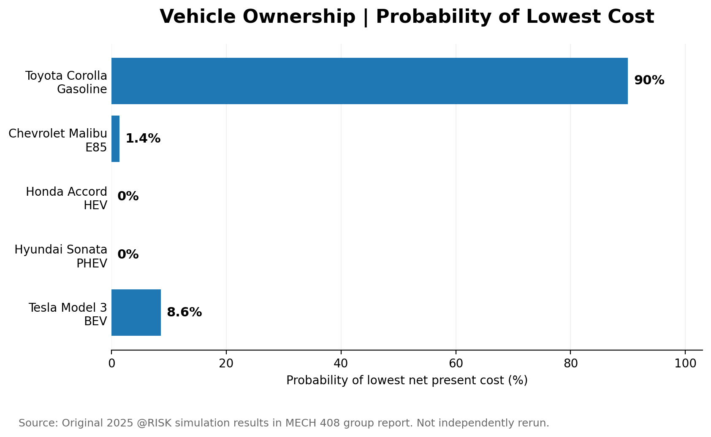

# Vehicle Ownership Cost Analysis: Gasoline vs. Alternative Fuels

**Tools:** Microsoft Excel, @RISK (original coursework)  
**Project Type:** Cost Modeling, Risk Analysis, Monte Carlo Simulation  
**Course:** MECH 408 – Applied Engineering Economy  
**Completed:** Spring 2025 (Group Project)

## Project Overview

This project compares the six-year financial cost of owning five different vehicle types:

1. Conventional gasoline
2. E85 flex-fuel
3. Hybrid electric vehicle (HEV)
4. Plug-in hybrid electric vehicle (PHEV)
5. Battery electric vehicle (BEV)

The goal was to identify which vehicle type offered the lowest estimated net present cost while accounting for uncertainty in operating costs and other financial assumptions.

## Project Files

- [View Original Excel Model](excel/vehicle-ownership-original.xlsx)
- [View Original Project Report (PDF)](report/vehicle-ownership-original-report.pdf)

The Excel workbook contains the original vehicle ownership cost models, including calculations for five vehicle alternatives and saved risk analysis results.

The PDF report documents the project assumptions, methodology, financial comparisons, Monte Carlo simulation results, and conclusions from the original group project.

## Objectives

- Compare the total cost of ownership across five vehicle categories.
- Develop a monthly cost model for a six-year ownership period.
- Account for financing, energy costs, maintenance, registration, incentives, and resale value.
- Apply probability distributions to uncertain inputs.
- Evaluate the likelihood that each alternative would have the lowest overall cost.

## Vehicles Evaluated

| Vehicle Type | Model | Assumed MSRP |
|---|---|---:|
| Gasoline | Toyota Corolla LE | $22,000 |
| E85 | Chevrolet Malibu LT | $28,000 |
| HEV | Honda Accord Hybrid | $32,000 |
| PHEV | Hyundai Sonata Plug-in | $34,000 |
| BEV | Tesla Model 3 RWD | $39,000 |

## Methodology

### Monthly Cost Modeling

An Excel model calculated ownership costs over 72 months.

The model considered:

- Vehicle purchase price and loan payments
- Gasoline, E85, and electricity expenses
- Estimated driving distances
- Routine maintenance
- Vehicle registration costs
- Home charging equipment
- Government incentives
- End-of-life resale value

A 6% annual discount rate was used in the present-value analysis.

### Uncertainty Analysis

Monte Carlo simulation was performed using @RISK during the original coursework.

Probability distributions were applied to selected inputs, including driving behavior, fuel prices, maintenance expenses, and resale value.

The simulation results were used to compare the cost distributions and probability of each vehicle being the least expensive option.

## Original Results

| Vehicle | Median Net Present Cost | Probability of Lowest Cost |
|---|---:|---:|
| Toyota Corolla (Gasoline) | $31,686 | 90.0% |
| Chevrolet Malibu (E85) | $35,531 | 1.4% |
| Honda Accord (HEV) | $40,624 | 0.0% |
| Hyundai Sonata (PHEV) | $45,345 | 0.0% |
| Tesla Model 3 (BEV) | $32,469 | 8.6% |

Under the original model assumptions, the Toyota Corolla had the lowest median net present cost and was the least expensive option in 90% of simulated scenarios.

The Tesla Model 3 was the least expensive option in 8.6% of scenarios, demonstrating how changes in operating costs and other assumptions can affect the relative competitiveness of electric vehicles.

## Results Visualizations

### Six-Year Vehicle Ownership Cost Comparison

The Toyota Corolla had the lowest median net present cost at $31,686, followed by the Tesla Model 3 at $32,469.

These results reflect the assumptions used in the original 2025 analysis, including financing, fuel costs, maintenance, incentives, and resale value.

### Probability of Lowest Ownership Cost

The original Monte Carlo simulation estimated a 90% probability that the Toyota Corolla would be the least expensive vehicle, followed by the Tesla Model 3 at 8.6% and the Chevrolet Malibu at 1.4%.

The simulation was originally performed using @RISK during coursework. These charts visualize the reported results rather than a newly executed simulation.

## Skills Demonstrated

- Excel modeling
- Research-based input assumptions
- Total cost of ownership analysis
- Monte Carlo simulation
- Probability distributions
- Sensitivity and uncertainty analysis
- Comparative data analysis
- Technical reporting

## Limitations

Vehicle prices, fuel costs, incentives, and other inputs reflect assumptions used in the original 2025 academic project.

These results are not intended to represent current vehicle prices or purchasing recommendations.

The original @RISK analysis was completed using university-provided software access. That license is no longer available, so saved simulation results are retained as historical coursework outputs rather than presented as a newly reproduced simulation.

## Project Background

Originally completed as a collaborative case study for MECH 408 at Colorado State University in Spring 2025.

The original report and workbook represent group coursework. Any future individual enhancements or recreated simulations will be documented separately.
