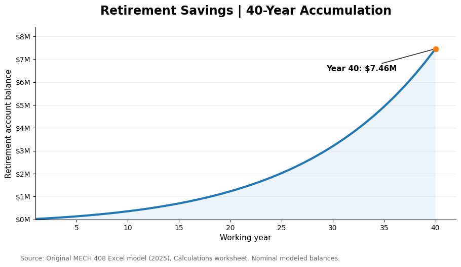
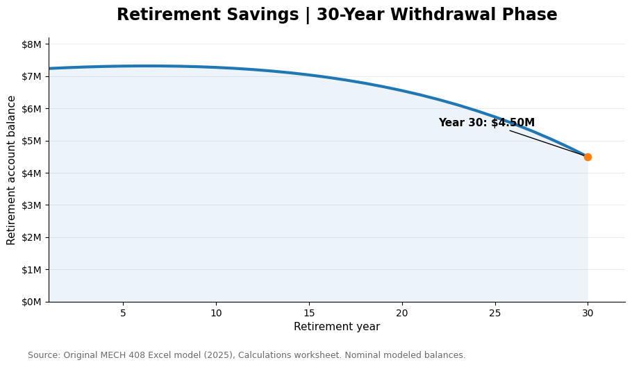

# Retirement Savings and Investment Growth Analysis

**Tools:** Microsoft Excel  
**Project Type:** Financial Forecasting and Sensitivity Analysis  
**Course:** MECH 408 – Applied Engineering Economy  
**Completed:** Spring 2025 (Individual Project)

## Project Overview

This project models the financial requirements for retirement by evaluating salary growth, annual savings, investment returns, inflation, and retirement withdrawals.

The scenario follows an individual beginning their career at age 25, retiring at age 65, and planning for 30 years of retirement.

The objective was to estimate the percentage of annual income that must be saved to support a retirement income equal to 70% of the final working salary.

## Key Assumptions

| Variable | Assumption |
|---|---|
| Starting Age | 25 |
| Retirement Age | 65 |
| Starting Annual Salary | $66,000 |
| Annual Salary Growth | 4% |
| Investment Return Before Retirement | 7% |
| Investment Return During Retirement | 3.5% |
| Inflation | 2.5% |
| Retirement Duration | 30 years |
| Retirement Income Target | 70% of Final Salary |

Taxes were excluded from the model.

## Methodology

An Excel model was developed to evaluate two financial phases.

### Accumulation Phase

The first phase models 40 years of employment, including:

- Annual salary increases
- Contributions to retirement savings
- Investment growth
- Accumulated retirement account balances

### Retirement Phase

The second phase models 30 years of retirement, including:

- Annual withdrawals
- Inflation-adjusted retirement expenses
- Continued investment returns
- Changes in the retirement account balance

### Sensitivity Analysis

The model examines how changing salary growth, investment returns, and inflation assumptions affects retirement outcomes.

## Original Results

Under the original assumptions, the model estimated that approximately **32% of annual salary** would need to be saved to meet the stated retirement income goal.

The original sensitivity analysis showed that investment performance, salary growth, and inflation assumptions significantly affected projected savings requirements and account balances.

## Results Visualizations

### Retirement Savings Accumulation

The model projects retirement account growth over 40 working years, reaching approximately $7.46 million by the end of the accumulation period.

The results demonstrate the long-term impact of consistent contributions and compound investment returns.

### Retirement Withdrawal Phase

During the 30-year retirement period, the account balance initially increases slightly before gradually declining as withdrawals grow.

Under the original model assumptions, the retirement account retains approximately $4.50 million at the end of the modeled period.

Both visualizations were recreated using the calculated values from the original 2025 Excel model.

## Skills Demonstrated

- Excel financial modeling
- Long-term forecasting
- Compound growth calculations
- Investment projections
- Sensitivity analysis
- Financial data visualization
- Scenario evaluation

## Limitations

This model uses hypothetical assumptions and constant annual rates of growth and return.

It does not incorporate taxes, unexpected expenses, investment market volatility, or changes in retirement regulations.

The results are educational projections rather than personalized financial advice.

## Project Background

Originally completed as an individual assignment for MECH 408 at Colorado State University in Spring 2025.

The workbook and results reflect the original academic analysis. Any subsequent improvements will be documented separately.
