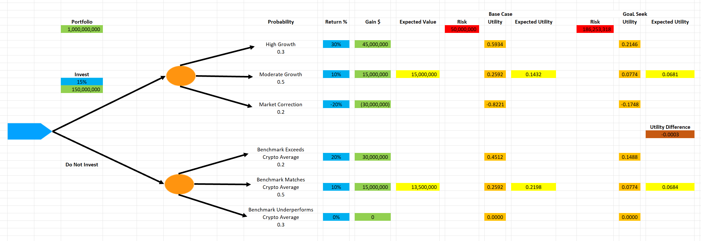

# Investment Risk and Decision Analysis

**Tools:** Microsoft Excel, Goal Seek  
**Project Type:** Probability and Decision Analysis  
**Course:** MECH 408 – Applied Engineering Economy  
**Completed:** Spring 2025 (Individual Project)

## Project Overview

This project examines how financial decisions can change when risk tolerance is considered alongside expected monetary returns.

A hypothetical investment firm, GlobalVest Partners, must decide whether to allocate 15% of its $1 billion portfolio to cryptocurrency investments or maintain its existing investment strategy.

The analysis uses decision trees, probabilities, expected monetary value, and expected utility to evaluate both options.

## Project Files

- [View Excel Decision Analysis Model](excel/investment-risk-decision-analysis.xlsx)
- [View Original Project Report (PDF)](report/investment-risk-decision-analysis-report.pdf)
- [View Original Decision Tree](visuals/investment-risk-decision-analysis-decision-tree.png)

The Excel workbook contains the original decision-tree model, probability calculations, expected monetary values, expected utility calculations, and Goal Seek analysis.

The PDF report documents the original methodology, assumptions, results, and conclusions from the Spring 2025 coursework.

## Results Visualization

### Investment Decision Tree

The decision tree compares two strategies: investing 15% of a $1 billion portfolio in cryptocurrency or maintaining the existing investment allocation.

Each alternative includes three possible outcomes with assigned probabilities and monetary gains.

Although investing produced a higher expected monetary gain ($15 million versus $13.5 million), maintaining the existing allocation produced a higher expected utility (0.2198 versus 0.1432) under the assumed $50 million risk tolerance.

This demonstrates how risk preferences can influence financial decisions beyond expected monetary returns.

The visualization and results are from the original 2025 Excel analysis.

## Objectives

- Construct a decision tree for two investment alternatives.
- Calculate expected monetary gains.
- Evaluate investment outcomes using a risk-averse utility function.
- Compare decisions based on expected value and expected utility.
- Determine how risk tolerance affects the preferred strategy.

## Methodology

### Investment Alternatives

The cryptocurrency allocation is $150 million.

The original assignment provides three possible market outcomes for each investment strategy, with assigned probabilities and monetary gains.

### Expected Value

Expected value was calculated by multiplying each possible financial outcome by its probability and summing the results.

### Expected Utility

The analysis uses the following utility function:

`U(W) = 1 - exp(-W/R)`

Where:

- `W` represents the monetary gain or loss.
- `R` represents risk tolerance.
- The initial risk tolerance was $50 million.

Excel Goal Seek was used to explore the risk tolerance value at which both strategies produced equivalent expected utility.

## Original Results

| Metric | Invest in Cryptocurrency | Do Not Invest |
|---|---:|---:|
| Expected Monetary Gain | $15 million | $13.5 million |
| Expected Utility | 0.1432 | 0.2198 |

Based on expected monetary value, investing in cryptocurrency was preferred.

However, based on expected utility, maintaining the existing investment strategy was preferred under the original risk tolerance assumption.

The original Goal Seek analysis identified an approximate risk tolerance threshold of $186.25 million.

## Key Takeaway

The option with the highest expected financial return is not necessarily the preferred choice when uncertainty and risk aversion are considered.

Decision-making can depend on both the probability of outcomes and the decision-maker's tolerance for potential losses.

## Skills Demonstrated

- Probability analysis
- Excel modeling
- Decision-tree analysis
- Expected value calculations
- Expected utility calculations
- Risk assessment
- Goal Seek
- Financial decision analysis

## Limitations

This project uses hypothetical market outcomes and assigned probabilities.

The model is intended to demonstrate decision analysis concepts and does not represent an investment recommendation or prediction of cryptocurrency performance.

## Project Background

Originally completed as an individual assignment for MECH 408 at Colorado State University in Spring 2025.
