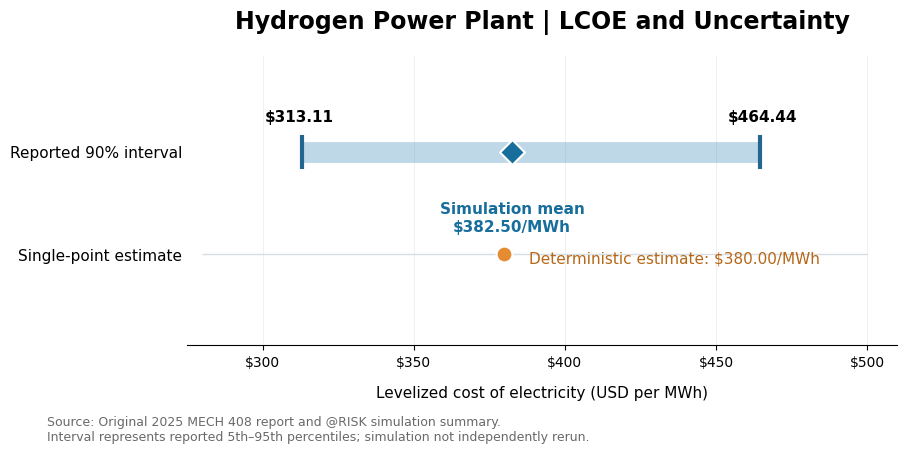

# Hydrogen Power Plant Economics: Levelized Cost of Electricity

**Tools:** Microsoft Excel, @RISK (original coursework)  
**Project Type:** Energy Economics and Uncertainty Analysis  
**Course:** MECH 408 – Applied Engineering Economy  
**Completed:** Spring 2025 (Individual Project)

## Project Overview

This project evaluates the estimated cost of electricity generation from a hypothetical 100 MW gas turbine power plant operating exclusively on green hydrogen.

The analysis calculates the levelized cost of electricity (LCOE) over a 20-year project lifetime.

The objective was to determine the estimated electricity production cost and identify the financial and technical variables that have the greatest influence on that cost.

## Project Files

- [View Original Excel Model](excel/hydrogen-power-plant-economics.xlsx)
- [View Original Project Report (PDF)](report/hydrogen-power-plant-economics-report.pdf)
- [View LCOE Uncertainty Graph](visuals/hydrogen-lcoe-uncertainty.png)

The Excel workbook contains the original hydrogen power plant economic model, including energy production, hydrogen consumption, operating costs, discounted cash flows, and LCOE calculations.

The PDF report documents the original methodology, assumptions, and @RISK simulation results from Spring 2025 coursework.

## Results Visualization

### Levelized Cost of Electricity and Uncertainty

The deterministic analysis estimated an LCOE of approximately $380.00/MWh, while the original Monte Carlo simulation reported a mean of $382.50/MWh.

The reported 90% simulation interval ranged from $313.11/MWh to $464.44/MWh, demonstrating the uncertainty associated with the modeled electricity generation costs.

The original analysis identified hydrogen fuel cost as the most influential variable affecting LCOE.

This visualization was created using summary statistics from the original 2025 coursework. The @RISK simulation was not independently rerun.

## Key Assumptions

| Variable | Assumption |
|---|---|
| Plant Capacity | 100 MW |
| Project Lifetime | 20 years |
| Capital Investment | $120 million |
| Fixed Annual O&M | $3.5 million |
| Variable O&M | $1.50/MWh |
| Hydrogen Fuel Cost | $7.50/kg |
| Hydrogen Heating Value | 130 MJ/kg |
| Plant Efficiency | 60% |
| Capacity Factor | 80% |
| Discount Rate | 15% |

## Methodology

### Energy Production

Annual electricity generation was calculated using plant capacity, capacity factor, and operating hours.

Hydrogen consumption was estimated based on energy generation requirements, fuel heating value, and plant efficiency.

### Financial Modeling

An Excel model was developed to evaluate:

- Initial capital expenditure
- Fixed operating and maintenance expenses
- Variable operating expenses
- Hydrogen fuel consumption and costs
- Discounted project costs
- Discounted electricity generation

### Levelized Cost of Electricity

The LCOE was calculated using:

`LCOE = Present Value of Total Costs / Present Value of Total Electricity Generated`

This metric expresses the modeled cost of electricity generation in dollars per megawatt-hour.

### Uncertainty Analysis

The original coursework included Monte Carlo simulation using @RISK to evaluate uncertainty in the estimated LCOE.

The simulation was used to investigate which inputs had the greatest influence on the results.

## Original Results

The original deterministic calculation produced an LCOE of approximately **$380.00/MWh**.

The original Monte Carlo simulation reported:

| Metric | Result |
|---|---:|
| Mean LCOE | $382.50/MWh |
| Standard Deviation | $45.89/MWh |
| Reported 90% Interval | $313.11–$464.44/MWh |
| Minimum Simulated LCOE | $221.22/MWh |
| Maximum Simulated LCOE | $567.99/MWh |

The analysis identified hydrogen fuel cost as the most influential variable affecting LCOE uncertainty.

## Skills Demonstrated

- Excel financial modeling
- Energy cost analysis
- Discounted cash flow calculations
- LCOE calculations
- Engineering economics
- Monte Carlo simulation
- Sensitivity analysis
- Technical reporting

## Limitations

The model represents a hypothetical hydrogen power plant and relies on assumptions provided in the original assignment.

Actual project economics would depend on location, hydrogen supply, technology, operational performance, financing, and changing market conditions.

The @RISK simulation was performed during the original coursework using university-provided software access. The original results are retained for documentation, but the simulation has not been independently reproduced.

## Project Background

Originally completed as an individual assignment for MECH 408 at Colorado State University in Spring 2025.

The original workbook and report document the academic analysis. Future enhancements will be identified separately.
